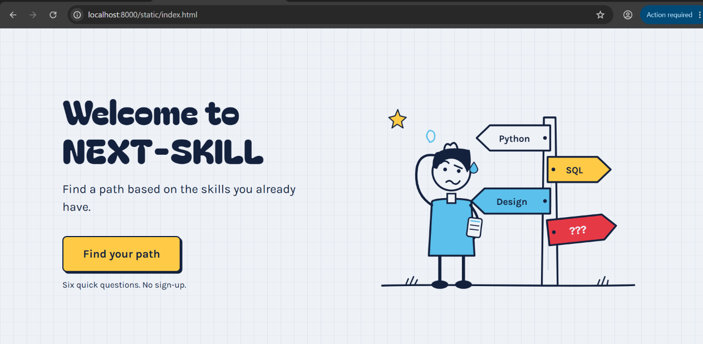
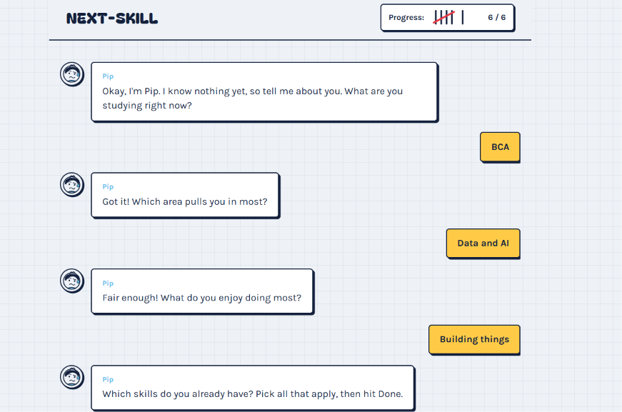
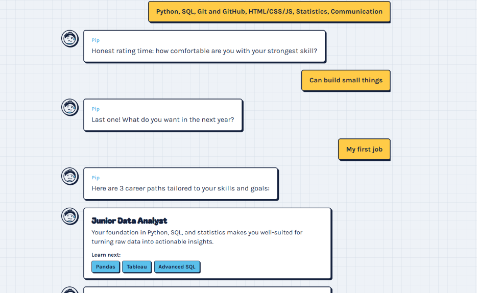
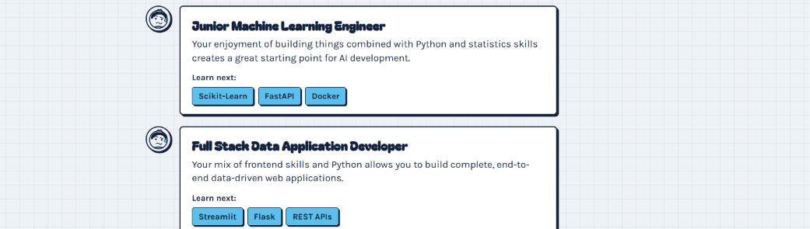

# UI Guide

How NEXT-SKILL looks and behaves for the user. The UI is plain HTML, CSS and JavaScript in the `static/` folder, served by the FastAPI app (`api.py`).

## Screens

| Screen | File | What it shows |
|--------|------|---------------|
| Welcome | `static/index.html` | Heading, one line of subtext, a "Find your path" button and a hand-drawn signpost illustration |
| Chat | `static/chat.html` | Pip, the chatbot, asks 6 questions and then shows 3 career suggestions |






## User flow

1. Open `http://localhost:8000` and read the welcome page.
2. Click **Find your path**. This opens the chat.
3. Answer 6 questions from Pip by tapping chips (or typing your own answer).
4. Wait a few seconds while the page sends the answers to `/api/suggest`.
5. Read your 3 career suggestions, each with skills to learn next.
6. Click **Start over** to try different answers.

## The six questions

Pip asks one at a time. Every question also has a "Something else" chip so the user can type their own answer.

| # | Question | Chips |
|---|----------|-------|
| 1 | What are you studying right now? | BCA, BSc IT / CS, B.Tech, Something else |
| 2 | Which area pulls you in most? | Websites and apps, Data and AI, Databases and backend, Design, Security, No idea yet |
| 3 | What do you enjoy doing most? | Building things, Digging into data, Designing how it looks, Explaining things to people |
| 4 | Which skills do you already have? (pick all that apply, then Done) | Python, SQL, Git and GitHub, HTML/CSS/JS, Statistics, Communication |
| 5 | Honest rating time: how comfortable are you with your strongest skill? | Just started, Can build small things, Can build real projects |
| 6 | Last one! What do you want in the next year? | An internship, My first job, Freelance work, Higher studies |

## What the chat sends to the API

After question 6, the chat page sends one JSON request to `POST /api/suggest`:

```json
{
  "field": "BCA",
  "interest": "Data and AI",
  "enjoy": "Building things",
  "skills": ["Python", "SQL"],
  "level": "Can build small things",
  "goal": "My first job"
}
```

The API replies with 3 suggestions. Each has a role, a one-sentence reason, and 2-3 skills to learn next. See `API_README.md` for details.

## Chat behaviour

- **Pip types first.** The bot shows a short typing pause before each question.
- **Bot messages** look like sticky notes with an ink outline. **User answers** appear as yellow marker-highlighted notes on the right.
- **Progress** is shown as tally marks in the header, filling in to 6 as questions are answered.
- **Results** appear as cards: the role as a title, one line on why it fits, and "Learn next" chips.
- **Safe text.** AI replies and typed answers are inserted as plain text, never as HTML.

## Look and feel

The design is a student's graph-paper notebook: playful and a little self-mocking, not a SaaS landing page.

| Part | Choice |
|------|--------|
| Background | Graph-paper grid on paper `#EEF2F7` |
| Ink | Navy `#14213D` |
| Primary accent | Marker yellow `#FFCB47` for buttons and user answers |
| Secondary accent | Sky `#5BC0EB` for small details and chips |
| Warning accent | Cherry `#E63946`, used sparingly |
| Headings | Bagel Fat One (Google Fonts) |
| Body text | Karla (Google Fonts) |
| Buttons and cards | Ink outline with a hard offset shadow |
| Motion | The signpost arrows wobble once on the welcome page. Reduced-motion settings are respected. |

## Accessibility

- Chips and buttons can be reached and used with the keyboard, with visible focus.
- New chat messages are announced to screen readers.
- The layout works on narrow mobile screens, and chips wrap instead of overflowing.

## Messages the user may see

| Situation | What happens |
|-----------|--------------|
| API key missing or rejected | Pip shows a friendly error saying the key needs checking |
| Gemini rate limit | Pip asks the user to wait a minute and try again |
| No internet or Gemini down | Pip says the service could not be reached |
| Unreadable reply | Pip says the reply could not be read and offers **Try again** |

Results always come with the reminder: **This is a suggestion, not a verdict.**

## Planned for later phases

- Phase 2: show matched skills versus missing skills.
- Phase 3: feedback form, deployment, and tests for the UI flow.